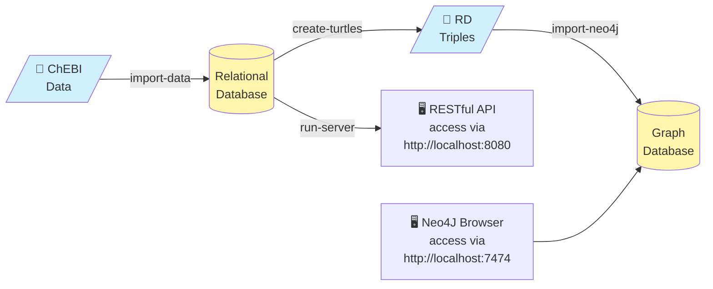

# BioKb-ChEBI


BioKb-ChEBI (biokb_chebi) is a python package to import ChEBI data into a relational database and create RDF triples (turtles) from it. The turtles can be imported into a Neo4J graph database. The package is part of the [BioKb family of packages](https://github.com/biokb) to create and connect biological and medical knowledge bases and graphs.

## Quick start

Make sure you have installed `uv` and `podman` yet, otherwise follow the instructions in [How to install uv](how_to_install_uv.md) and [How to install podman](how_to_install_podman.md). 

Start a new terminal session and follow the instructions for your operating system below.
```terminal
podman run --rm --name biokb-neo4j -p7474:7474 -p7687:7687 -e NEO4J_AUTH=neo4j/neo4j_password neo4j:5.26.31
```
In an additional terminal session execute the following commands according to your operating system.

Following commands will:

1. Create a project directory and navigate into it. # line 1-2
2. Set up a virtual environment and activate it. # line 3-4
3. Install the `biokb_chebi` package. # line 5
4. Import ChEBI data and create RDF triples (tutrtle files). # line 6-7
5. Run a Neo4J container and import the RDF triples into it. # line 8
6. Import the RDF triples into the Neo4J database. # line 9
7. Open the Neo4J Browser to explore the imported data. # line 10

=== "Windows PowerShell"

    Open PowerShell (not CMD) and run the following commands:
    ```powershell linenums="1"
    mkdir biokb_chebi
    cd biokb_chebi
    uv venv
    .venv\Scripts\Activate.ps1
    uv pip install biokb_chebi
    biokb_chebi import-data
    biokb_chebi create-turtles
    biokb_chebi import-neo4j
    biokb_chebi run-server
    ```

=== "Windows CMD"

    Open CMD (not PowerShell) and run the following commands:
    ```cmd linenums="1"
    mkdir biokb_chebi
    cd biokb_chebi
    uv venv
    .venv\Scripts\activate.bat 
    uv pip install biokb_chebi
    biokb_chebi import-data
    biokb_chebi create-turtles
    biokb_chebi import-neo4j
    biokb_chebi run-server
    ```


=== "macOS"
    Open your terminal and run the following commands:
    ```bash linenums="1"
    mkdir biokb_chebi
    cd biokb_chebi
    uv venv
    source .venv/bin/activate
    uv pip install biokb_chebi
    biokb_chebi import-data
    biokb_chebi create-turtles
    biokb_chebi import-neo4j
    biokb_chebi run-server
    ```

=== "Linux"
    Open your terminal and run the following commands:
    ```bash linenums="1"
    mkdir biokb_chebi
    cd biokb_chebi
    uv venv
    source .venv/bin/activate
    uv pip install biokb_chebi
    biokb_chebi import-data
    biokb_chebi create-turtles
    biokb_chebi import-neo4j
    biokb_chebi run-server
    ```

Now you can open:

1. [Neo4J Browser](http://localhost:7474) to explore & query the graph database
2. [Restful API (FastAPI)](http://localhost:8000) for interacting with the service

By default a SQLite database is used for storing ChEBI data. Which you find ...

=== "Windows"
    `C:\Users\<YourUsername>\.biokb_chebi\biokb.db`
    
=== "macOS"
    `~/.biokb_chebi/biokb.db`

=== "Linux"
    `~/.biokb_chebi/biokb.db`
    
To explore and query the SQLite database, you can use [DB Browser for SQLite](https://sqlitebrowser.org/)

For advanced configuration like using a different database backend or customizing the Neo4J connection, using podman or other containerization options, refer to the [advanced guide](advanced_guide.md).

## Overview

### Why BioKb-ChEBI?

BioKb-ChEBI simplifies the process of importing, managing, and querying ChEBI data by providing a unified interface for relational databases, RDF triples, and graph databases. It allows researchers and developers to efficiently work with chemical entity data using familiar tools and standards. BioKb-ChEBI is part of the BioKb ecosystem, which aims to streamline the management and utilization of biological knowledge bases.

### Why ChEBI is important

ChEBI (Chemical Entities of Biological Interest) is a freely available dictionary of molecular entities focused on 'small' chemical compounds. It provides a structured and curated vocabulary for chemical entities, which is essential for data integration, interoperability, and computational analysis in the life sciences. By using ChEBI, researchers can ensure consistent annotation and facilitate the discovery of relationships between chemical entities and biological data.

### General Architecture

***Fig. 1***: *General architecture of BioKb-ChEBI. Data from ChEBI is downloaded and imported into a relational database, transformed into RDF triples, and then imported into a Neo4J graph database. The relational database is accessible via SQL clients and also serves a RESTful API for querying and data management.*

## Features

biokb_chebi allows to ...

1. Query ChEBI data with SQLAlchemy or raw SQL
2. Load, query and manage ChEBI data with GUIs for knowledge base and graphs (phpMyAdmin, Neo4J Browser)
3. Query data via a RESTful API (FastAPI) with OpenAPI documentation and interactive Swagger-UI

to provide this ***biokb_chebi*** ...

- imports [ChEBI](https://www.ebi.ac.uk/chebi/) data into a relational database 
- creates [RDF](https://www.w3.org/RDF/) triples (turtles) from the relational database
- imports the RDF triples into a [Neo4J](https://neo4j.com) graph database

***Supported databases***: [SQLite](https://sqlite.org/), [MariaDB](https://go.mariadb.com)/[MySQL](https://www.mysql.com/), [PostgreSQL](https://www.postgresql.org/), [Oracle](https://www.oracle.com/database/), [Microsoft SQL Server](https://www.microsoft.com/en-us/sql-server), and any other database [supported by SQLAlchemy](https://docs.sqlalchemy.org/en/20/core/engines.html#supported-databases).


### Options to run BioKb-ChEBI

All biokb packages share the same API and CLI structure. You have different options to run the packages:

1. [from command line](run_the_pipeline.md#from-command-line) (simplest way to get started)
2. [as RESTful API server](run_the_pipeline.md#as-restful-api-server) (can start directly from command line)
3. [as Podman/Docker container](run_the_pipeline.md#as-podmandocker-container) (without import into Neo4J, but export of turtles possible)
4. [as Podman/Docker networked containers](run_the_pipeline.md#as-podman-networked-containers) (with all features) and 3 containers: 
   1. high-performance relational databases (PostgreSQL, Oracle, MySQL, ...)
   2. RESTful API (fastAPI) for queries, data import and export
   3. GUI for querying and administration of MySQL over the Web